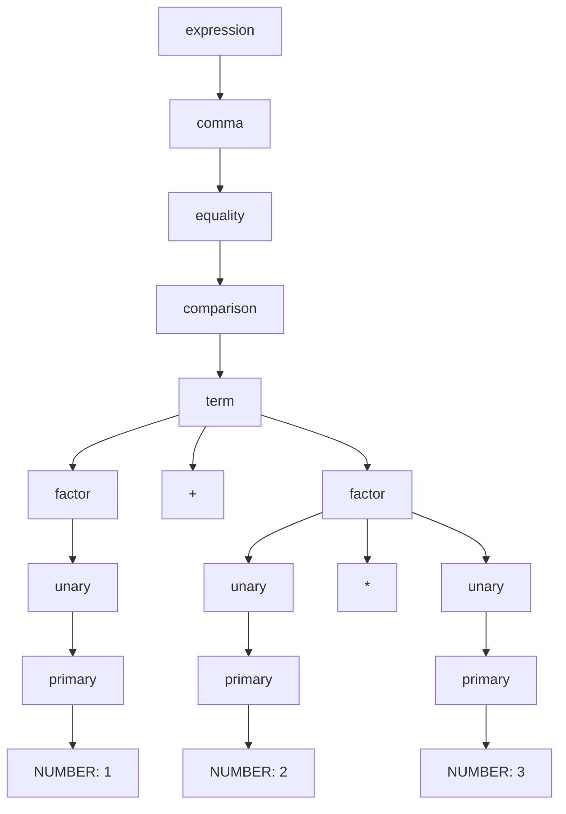

# Dante Givens - CIS 343 01 - 10/16/26

## Nios - Lab 3 Parser Test Report

## Expression Grammar:

```text
expression -> comma ;
comma      -> equality ( "," equality )* ;
equality   -> comparison ( ("==" | "!=") comparison )* ;
comparison -> term ( (">" | ">=" | "<" | "<=") term )* ;
term       -> factor ( ("+" | "-") factor )* ;
factor     -> unary ( ("*" | "/") unary )* ;
unary      -> ("!" | "-") unary | primary ;
primary    -> NUMBER | WORD | "true" | "false" | "nil"
            | "(" expression ")" ;
```
  
<br>

## Literal Types:

Nios still supports integer and decimal Number literals, Word literals, the Boolean literals `true` and `false`, and `nil`. A Word is my language's name for a string. The scanner gets the literal value, and the parser puts that value into a `Literal` node. The AST printer displays the values using Nios spelling instead of Python's `True`, `False`, and `None`.  
<br>

## Precedence and Associativity:

These levels are listed from lowest priority to highest priority:

| Level | Operators or form | Associativity |
| --- | --- | --- |
| Comma | `,` | Left to right |
| Equality | `==`, `!=` | Left to right |
| Comparison | `>`, `>=`, `<`, `<=` | Left to right |
| Term | `+`, `-` | Left to right |
| Factor | `*`, `/` | Left to right |
| Unary | `!`, `-` | Right to left |
| Primary | Literals and `(expression)` | Parentheses keep the inside expression together |

Each parser method calls the next higher priority method before combining its own operators. This makes `1 + 2 * 3` become `(+ 1 (* 2 3))`. The multiplication goes inside the right side of the addition.

Binary operators at the same level group from the left. For example, `8 - 3 - 1` becomes `(- (- 8 3) 1)`. Unary operators call `unary()` again, so `!-1` becomes `(! (- 1))`. Grouping starts over at `expression()` so all operators are allowed inside the parentheses.  
<br>

### Grammar Changes Since Lab 2

- Lab 2 used a general `binary -> expression operator expression` rule because the trees were built directly in Python. That rule did not say which operator should happen first.
- Lab 3 separates the operators into precedence levels and defines their associativity.
- I added the comma operator at the lowest precedence level.

### Design Choices Relative to Lox

- Nios uses a recursive descent parser like Lox. Each grammar rule has a matching method in the `Parser` class.
- I reused the scanner, token classes, `Literal`, `Unary`, `Binary`, `Group`, and the AST printer from the previous labs.
- My tokens use `type` for the broad category and `symbol` for the specific operator. `matchSymbols()` checks both.
- The AST printer still uses type checks instead of Lox's Visitor classes.
- `parse()` accepts exactly one expression. If anything besides EOF remains, it reports an unexpected trailing token.
- `ParseError` is a separate exception type. The main program catches it, prints the diagnostic, and does not print an AST for that input.
- Since each input contains one expression, parsing stops at the first syntax error. In interactive mode, the next line gets a new scanner and parser.
- The comma operator uses the existing `Binary` class. It does not need a new AST class.  
<br>

## Scanner, Parser, and Printer Integration:

The main program is [nios.py](../src/nios.py). `scanSource()` scans the input and checks the scanner's error list first. If there are lexical errors, it prints them and returns without parsing. Otherwise, it builds the AST with `Parser.parse()` and prints it with `AstPrinter.print()`.

Source-file mode reads the whole `.nios` file as one expression. Interactive mode reads one expression per line. A successful input prints a tree, not the individual tokens and not the evaluated answer. Syntax errors include a line number and the token where the problem was found, or `end of input` when the parser reaches EOF.  
<br>

## Extra Credit

### C-style Comma Operator

**Feature and effort:** I added a `comma()` rule between `expression()` and `equality()`. It keeps combining expressions from the left and has lower priority than every other binary operator. My scanner already supported comma tokens, and the parser now turns them into `Binary` nodes.

**Value:** One expression can contain several comma-separated expressions.

**Test evidence:** The operator, precedence, associativity, grouping, and syntax-error tests include comma cases. For example, `1, 2, 3` should print `(, (, 1 2) 3)`, and `1, 2 == 3` should print `(, 1 (== 2 3))`. The test tables below include these cases and invalid uses such as `1,,2`.

### Missing Left Operand

**Feature and effort:** In `primary()`, I check for binary operators that cannot start an expression. This gives a more specific message than just saying an expression was expected. Minus is left out of this check because it can start a valid unary expression.

**Value:** An input such as `* 2` tells the user that `*` is missing its left operand and identifies where it happened.

**Expected diagnostic:**

```text
[line 1] Error at '*': Missing left operand before '*'.
```

**Test evidence:** The syntax-error cases test this with each supported binary-only operator, including comma. They also test operators in the middle of an expression and inside parentheses.  
<br>

# Dependencies and Setup

Nios only requires Python and uses no third-party packages. It was tested with Python 3.15.0 on Windows. Use Python 3.10 or newer to avoid the older standard-library `parser` module name conflict described under Known Errors.

From the repository root, enter the interpreter folder:

```powershell
cd Interpreter
```

Run a source file:

```powershell
python src/nios.py test/lab3/testFiles/precedence.nios
```

Run interactive mode:

```powershell
python src/nios.py
```

Exit with `Ctrl+C` or `Ctrl+Z` followed by Enter on Windows. If `python` is not available as a command, use the Python launcher, such as `py -3.15`, in its place.

The implementation files are under [src/](../src/). The parser is [parser.py](../src/parser.py), and the reused files are [scanner.py](../src/scanner.py), [token.py](../src/token.py), [expression.py](../src/expression.py), and [astPrinter.py](../src/astPrinter.py).  
<br>
<br>

# Testing

### *Please note, the Lab 3 tests and test files are almost entirely AI generated and self reviewed.
<br>

## Run the Manual Examples:

```powershell
python src/nios.py test/lab3/testFiles/precedence.nios
python src/nios.py test/lab3/testFiles/grouping.nios
python src/nios.py test/lab3/testFiles/missingOperand.nios
```

| File | Purpose | Source input | Expected and actual output |
| --- | --- | --- | --- |
| [precedence.nios](../test/lab3/testFiles/precedence.nios) | Multiplication before addition | `1 + 2 * 3` | `(+ 1 (* 2 3))` |
| [grouping.nios](../test/lab3/testFiles/grouping.nios) | Grouping inside unary minus and multiplication | `-(1 + 2) * 3` | `(* (- (group (+ 1 2))) 3)` |
| [missingOperand.nios](../test/lab3/testFiles/missingOperand.nios) | Missing operand before a closing parenthesis | `1 + )` | `[line 1] Error at ')': Expected an expression.` |

**Result:** All three outputs match expectations. The invalid expression prints only the error, without an AST.

## Run All Automated Tests:

```powershell
python test/lab3/runAllUnitTests.py
```

Run one test group:

```powershell
python test/lab3/unitTests/testParser.py ParserTestCase.testPrecedence
```

The runner discovers tests in [test/lab3/unitTests/](../test/lab3/unitTests/). The source inputs and expected outputs are in [expressionCases.py](../test/lab3/testFiles/expressionCases.py). The tests write temporary `.nios` files, run the main program, compare its output, and remove the temporary files afterward. They also check that the process exits normally and does not write a Python traceback.

The tables below list every case from that file. Sections 1 through 7 run each case in both file and interactive modes. In interactive mode, the program also prints `REPL mode` once before the results. Section 8 uses source files because the inputs contain multiple lines.

**Actual output and result for the tables:** Each output shown below is both the expected output and the actual program output. All 107 cases matched in their stated modes. Sections 1 through 7 contain 96 cases tested in both modes, and Section 8 adds 11 multiline file cases. That makes 203 individual checks before the separate interactive recovery and EOF tests.

## Test Cases

### 1 - Every Literal Type &nbsp;&nbsp;&nbsp;&nbsp; Automated Test Name: `testLiteralTypes`

**Purpose:** Verify integer and decimal Numbers, Words, both Booleans, and nil. Also check empty Words and symbols inside a Word.

| Source input | Expected and actual AST output |
| --- | --- |
| `0` | `0` |
| `123` | `123` |
| `45.67` | `45.67` |
| `0.0` | `0.0` |
| `"hello world"` | `"hello world"` |
| `""` | `""` |
| `"+ ! ( ) /* text */"` | `"+ ! ( ) /* text */"` |
| `true` | `true` |
| `false` | `false` |
| `nil` | `nil` |

### 2 - Every Operator &nbsp;&nbsp;&nbsp;&nbsp; Automated Test Name: `testEveryOperator`

**Purpose:** Verify that every supported binary and unary operator produces the correct tree. Each row tests the operator shown in its source input.

| Source input | Expected and actual AST output |
| --- | --- |
| `1, 2` | `(, 1 2)` |
| `1 + 2` | `(+ 1 2)` |
| `1 - 2` | `(- 1 2)` |
| `1 * 2` | `(* 1 2)` |
| `1 / 2` | `(/ 1 2)` |
| `1 == 2` | `(== 1 2)` |
| `1 != 2` | `(!= 1 2)` |
| `1 < 2` | `(< 1 2)` |
| `1 <= 2` | `(<= 1 2)` |
| `1 > 2` | `(> 1 2)` |
| `1 >= 2` | `(>= 1 2)` |
| `-123` | `(- 123)` |
| `!false` | `(! false)` |

### 3 - Operator Precedence &nbsp;&nbsp;&nbsp;&nbsp; Automated Test Name: `testPrecedence`

**Purpose:** Verify that higher priority operators stay deeper in the tree even when the order of the operators changes.

| Source input | Expected and actual AST output | What it checks |
| --- | --- | --- |
| `1 + 2, 3 * 4` | `(, (+ 1 2) (* 3 4))` | Arithmetic before comma |
| `1, 2 + 3` | `(, 1 (+ 2 3))` | Addition before comma |
| `1, 2 == 3` | `(, 1 (== 2 3))` | Equality before comma |
| `1 + 2 * 3` | `(+ 1 (* 2 3))` | Multiplication on the right |
| `2 * 3 + 1` | `(+ (* 2 3) 1)` | Multiplication on the left |
| `8 - 6 / 2` | `(- 8 (/ 6 2))` | Division before subtraction |
| `6 / 2 - 1` | `(- (/ 6 2) 1)` | Division on the left |
| `1 + 2 < 4 - 1` | `(< (+ 1 2) (- 4 1))` | Arithmetic before comparison |
| `1 < 2 == 3 >= 2` | `(== (< 1 2) (>= 3 2))` | Comparison before equality |
| `-2 * 3` | `(* (- 2) 3)` | Unary minus on the left |
| `2 * -3` | `(* 2 (- 3))` | Unary minus on the right |
| `!false == true` | `(== (! false) true)` | Unary negation before equality |
| `-1 + 2 * 3 < 8 == !false` | `(== (< (+ (- 1) (* 2 3)) 8) (! false))` | Several precedence levels together |

### 4 - Associativity &nbsp;&nbsp;&nbsp;&nbsp; Automated Test Name: `testAssociativity`

**Purpose:** Verify left grouping for binary operators at the same level and right grouping for repeated unary operators.

| Source input | Expected and actual AST output |
| --- | --- |
| `1, 2, 3` | `(, (, 1 2) 3)` |
| `8 - 3 - 1` | `(- (- 8 3) 1)` |
| `8 / 4 / 2` | `(/ (/ 8 4) 2)` |
| `8 + 3 - 1` | `(- (+ 8 3) 1)` |
| `8 / 4 * 2` | `(* (/ 8 4) 2)` |
| `1 < 2 <= 3` | `(<= (< 1 2) 3)` |
| `true == false != nil` | `(!= (== true false) nil)` |
| `!!true` | `(! (! true))` |
| `--1` | `(- (- 1))` |
| `!-1` | `(! (- 1))` |

### 5 - Nested Grouping &nbsp;&nbsp;&nbsp;&nbsp; Automated Test Name: `testNestedGrouping`

**Purpose:** Verify that parentheses create `Group` nodes, can contain other groups, and can change the usual precedence or associativity.

| Source input | Expected and actual AST output |
| --- | --- |
| `(1, 2) * 3` | `(* (group (, 1 2)) 3)` |
| `1, (2, 3)` | `(, 1 (group (, 2 3)))` |
| `(1)` | `(group 1)` |
| `(((1)))` | `(group (group (group 1)))` |
| `(1 + 2) * 3` | `(* (group (+ 1 2)) 3)` |
| `8 - (3 - 1)` | `(- 8 (group (- 3 1)))` |
| `(1 + (2 * (3 - 4)))` | `(group (+ 1 (group (* 2 (group (- 3 4))))))` |
| `-123 * (45.67)` | `(* (- 123) (group 45.67))` |
| `!(true == false)` | `(! (group (== true false)))` |

### 6 - Syntax Errors &nbsp;&nbsp;&nbsp;&nbsp; Automated Test Name: `testSyntaxErrors`

**Purpose:** Verify unmatched parentheses, missing operands, unexpected expression tokens, and trailing tokens. Every case should print an error without printing a successful AST.

| Source input | Expected and actual error | Cause |
| --- | --- | --- |
| `(1 + 2` | `[line 1] Error at end of input: Expected ')' after expression.` | The opening parenthesis is not closed. |
| `((1)` | `[line 1] Error at end of input: Expected ')' after expression.` | The outer group is not closed. |
| `(1 2)` | `[line 1] Error at '2': Expected ')' after expression.` | After `1`, the parser needs the group's closing parenthesis, not another literal. |
| `1)` | `[line 1] Error at ')': Unexpected token after expression.` | There is an extra closing parenthesis. |
| `()` | `[line 1] Error at ')': Expected an expression.` | The group is empty. |
| `1 +` | `[line 1] Error at end of input: Expected an expression.` | Addition is missing its right operand. |
| `!` | `[line 1] Error at end of input: Expected an expression.` | Unary negation is missing its operand. |
| `-` | `[line 1] Error at end of input: Expected an expression.` | Unary minus is missing its operand. |
| `(1 + )` | `[line 1] Error at ')': Expected an expression.` | The group closes before the right operand. |
| `, 1` | `[line 1] Error at ',': Missing left operand before ','.` | Comma cannot begin an expression. |
| `1,,2` | `[line 1] Error at ',': Missing left operand before ','.` | There is no expression between the commas. |
| `(, 1)` | `[line 1] Error at ',': Missing left operand before ','.` | Comma has no left operand inside the group. |
| `1,` | `[line 1] Error at end of input: Expected an expression.` | Comma is missing its right operand. |
| `+ 2` | `[line 1] Error at '+': Missing left operand before '+'.` | Nios has no unary plus. |
| `* 2` | `[line 1] Error at '*': Missing left operand before '*'.` | Multiplication is missing its left operand. |
| `/ 2` | `[line 1] Error at '/': Missing left operand before '/'.` | Division is missing its left operand. |
| `== 2` | `[line 1] Error at '==': Missing left operand before '=='.` | Equality is missing its left operand. |
| `!= 2` | `[line 1] Error at '!=': Missing left operand before '!='.` | Inequality is missing its left operand. |
| `> 2` | `[line 1] Error at '>': Missing left operand before '>'.` | Comparison is missing its left operand. |
| `>= 2` | `[line 1] Error at '>=': Missing left operand before '>='.` | Comparison is missing its left operand. |
| `< 2` | `[line 1] Error at '<': Missing left operand before '<'.` | Comparison is missing its left operand. |
| `<= 2` | `[line 1] Error at '<=': Missing left operand before '<='.` | Comparison is missing its left operand. |
| `1 + * 2` | `[line 1] Error at '*': Missing left operand before '*'.` | `*` appears where the operand after `+` belongs. |
| `(* 2)` | `[line 1] Error at '*': Missing left operand before '*'.` | Multiplication cannot start the group. |
| `! == 2` | `[line 1] Error at '==': Missing left operand before '=='.` | Equality cannot start the operand after `!`. |
| `*` | `[line 1] Error at '*': Missing left operand before '*'.` | A binary operator alone is not an expression. |
| `name` | `[line 1] Error at 'name': Expected an expression.` | Labels are not part of this expression grammar. |
| `show 1` | `[line 1] Error at 'show': Expected an expression.` | Statements are not supported yet. |
| `1 2` | `[line 1] Error at '2': Unexpected token after expression.` | Two separate expressions are not allowed. |
| `1;` | `[line 1] Error at ';': Unexpected token after expression.` | Expressions do not end with a semicolon. |
| `1 = 2` | `[line 1] Error at '=': Unexpected token after expression.` | Assignment is not an expression operator in this grammar. |
| `true and false` | `[line 1] Error at 'and': Unexpected token after expression.` | Logical `and` is not supported. |
| `true or false` | `[line 1] Error at 'or': Unexpected token after expression.` | Logical `or` is not supported. |
| Empty input | `[line 1] Error at end of input: Expected an expression.` | There are no expression tokens. |
| Three spaces | `[line 1] Error at end of input: Expected an expression.` | Whitespace does not make an expression. |
| `// only a comment` | `[line 1] Error at end of input: Expected an expression.` | The comment is ignored, leaving no expression. |

### 7 - Lexical Errors &nbsp;&nbsp;&nbsp;&nbsp; Automated Test Name: `testLexicalErrors`

**Purpose:** Verify that scanner errors prevent parsing and AST output, even when part of the input could be parsed successfully.

| Source input | Expected and actual error | Cause |
| --- | --- | --- |
| `1 @` | `[line 1] Error: Unexpected character '@'.` | `@` is not a Nios token. The valid `1` must not print as an AST. |
| `1 + @` | `[line 1] Error: Unexpected character '@'.` | The scanner error is reported before attempting to parse. |
| `"unfinished` | `[line 1] Error: Unterminated string.` | The Word has no closing quote. |
| `1 /* unfinished` | `[line 1] Error: Unterminated block comment.` | The block comment has no closing `*/`. |
| `1 @ #` | `[line 1] Error: Unexpected character '@'.`<br>`[line 1] Error: Unexpected character '#'.` | Both invalid characters are reported, on separate lines. |

### 8 - Multiline Source Files &nbsp;&nbsp;&nbsp;&nbsp; Automated Test Name: `testMultilineFiles`

**Purpose:** Verify that files can contain multiline expressions, Words, and comments, and that errors use the correct line number.

In the source column, `\n` represents an actual newline in the file. In the output column, `\n` is the literal text printed by the AST printer to keep a multiline Word on one output line.

| Source input | Expected and actual output | What it checks |
| --- | --- | --- |
| `1,\n2` | `(, 1 2)` | Comma across lines |
| `1,\n,2` | `[line 2] Error at ',': Missing left operand before ','.` | Missing expression between commas on line 2 |
| `(1 +\n2) * 3` | `(* (group (+ 1 2)) 3)` | Grouping across lines |
| `"hello\nworld"` | `"hello\nworld"` | Multiline Word |
| `1 /* outer\n/* inner */ done */ + 2 // done` | `(+ 1 2)` | Nested block comments and a line comment |
| `1 +\n* 2` | `[line 2] Error at '*': Missing left operand before '*'.` | Invalid operator on line 2 |
| `(1 +\n2` | `[line 2] Error at end of input: Expected ')' after expression.` | Missing closing parenthesis at EOF on line 2 |
| `1\n2` | `[line 2] Error at '2': Unexpected token after expression.` | Extra expression on line 2 |
| `1 +\n@ 2` | `[line 2] Error: Unexpected character '@'.` | Lexical error on line 2 |
| `\n"unfinished` | `[line 2] Error: Unterminated string.` | Word opens on line 2 but never closes |
| `1\n/* unfinished` | `[line 2] Error: Unterminated block comment.` | Comment opens on line 2 but never closes |

### 9 - Interactive Recovery After Errors &nbsp;&nbsp;&nbsp;&nbsp; Automated Test Name: `testInteractiveRecovery`

**Purpose:** Verify that the same interactive session remains usable after each supported syntax or lexical error.

**Source input:** The automated test starts with `2 * 3`. It then enters every source from Sections 6 and 7 in order, following each error input with `1 + 2`. All inputs are sent to one process, so restarting the program cannot hide a recovery failure.

**Expected output:** `REPL mode`, then `(* 2 3)`, then each error shown in Sections 6 and 7 followed by `(+ 1 2)`. An error must not produce an AST of its own.

An example of the beginning of that session is:

```nios
2 * 3
(1 + 2
1 + 2
((1)
1 + 2
```

**Expected and actual output for this excerpt:**

```text
REPL mode
(* 2 3)
[line 1] Error at end of input: Expected ')' after expression.
(+ 1 2)
[line 1] Error at end of input: Expected ')' after expression.
(+ 1 2)
```

**Actual output and result:** The full session matches the expected sequence. All 41 syntax and lexical error inputs are followed by a successful `(+ 1 2)` without restarting the program.

### 10 - One Expression Per Interactive Line &nbsp;&nbsp;&nbsp;&nbsp; Automated Test Name: `testInteractiveInputEndsAtEachLine`

**Purpose:** Verify that an unfinished expression does not consume the next interactive line.

**Source input:**

```nios
(1 +
2
3 * 4
```

**Expected and actual output:**

```text
REPL mode
[line 1] Error at end of input: Expected an expression.
2
(* 3 4)
```

The first line is missing the operand after `+`. The next two lines are separate valid expressions.

**Result:** Matches expectations. The parser reports the first line's error, then accepts both following expressions.

### 11 - Interactive End of Input &nbsp;&nbsp;&nbsp;&nbsp; Automated Test Name: `testInteractiveEndOfInput`

**Purpose:** Verify a clean exit when interactive input ends immediately or after an expression without a final newline.

| Source input | Expected and actual output |
| --- | --- |
| EOF immediately, with no entered line | `REPL mode` |
| `1 + 2` followed immediately by EOF | `REPL mode`<br>`(+ 1 2)` |

Immediate EOF is different from entering an empty line. EOF exits the REPL; an empty line is submitted to the parser and reports a missing expression.

**Result:** Both cases match expectations and exit normally.  
<br>

# Example Syntax Tree

**Expression: 1 + 2 * 3**

This is a  syntax tree for the grammar at the beginning of the report. It shows every grammar rule node, including rules that just lead to another rule.



**Actual printed AST:**

```text
(+ 1 (* 2 3))
```

The concrete tree shows the addition in `term` and the multiplication inside its second `factor`. The AST removes the grammar nodes that do not add information. It keeps a `Binary` addition at the root, a `Literal` for `1` on the left, and a `Binary` multiplication containing `2` and `3` on the right. That is why `(* 2 3)` is nested inside the addition in the printed output.  
<br>

# Automated Test Result

Command:

```powershell
python test/lab3/runAllUnitTests.py
```

**Results on October 16, 2026:**

| Automated test | Result |
| --- | --- |
| `testAssociativity` | Passed |
| `testEveryOperator` | Passed |
| `testInteractiveEndOfInput` | Passed |
| `testInteractiveInputEndsAtEachLine` | Passed |
| `testInteractiveRecovery` | Passed |
| `testLexicalErrors` | Passed |
| `testLiteralTypes` | Passed |
| `testMultilineFiles` | Passed |
| `testNestedGrouping` | Passed |
| `testPrecedence` | Passed |
| `testSyntaxErrors` | Passed |

All 11 test methods passed. The captured full-run output ended during `testSyntaxErrors`, so that test was also run separately to confirm its result:

```powershell
python test/lab3/unitTests/testParser.py ParserTestCase.testSyntaxErrors
```

**Actual output:**

```text
testSyntaxErrors (__main__.ParserTestCase.testSyntaxErrors) ... ok

----------------------------------------------------------------------
Ran 1 test in 4.060s

OK
```

Passing these tests does not cover the separate issues listed below.  
<br>

## Known Errors

- On older Python installations where the legacy `parser` module is built in, Python can import it instead of my custom [parser.py](../src/parser.py). That module does not contain my `Parser` and `ParseError` classes, so the program can fail during import. The old module was removed in Python 3.10. Use Python 3.10 or newer to avoid this conflict. This is a compatibility issue; it was not reproduced in this report's current environment.

## Known Limitations

- This project currently  does not evaluate expressions.
- Labels, assignment, statements, logical `and` and `or`, and the ternary operator are not supported by this parser.
- Interactive mode does not continue an expression, Word, or block comment onto the next input line.
- Syntax errors stop parsing the current input after the first error. 
- The `.nios` extension check is case sensitive.